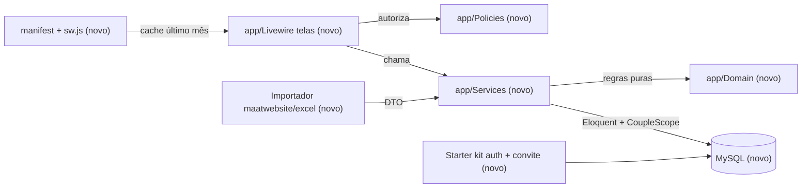

# Implementation Plan

## Request Summary
- Objective: construir o app "Nossa Finanças" (substitui a planilha `Planejamento_Ana_Claudia.xlsx`) para dois parceiros, com dados compartilhados, escrita só pelo dono, fluxo mensal, cartões, pessoas, vale, recorrência, acerto, metas, painel, relatório e importação de .xlsx, instalável como PWA.
- Scope: in = RF-01 a RF-31, UI-01 a UI-07, RNF-01 a RNF-08, CT-01 / out = Open Finance, multimoeda, múltiplos casais, push, exportação xlsx.
- Tier: complete
- Architecture references: missing (AVISO: repositório vazio, sem AGENTS.md, docs/agents ou copilot-instructions; este plano NÃO está validado contra arquitetura documentada. Recomenda-se rodar /ai-context após a Fase 1 e revisar a estrutura abaixo).

### Stack definitiva (decisão do desenvolvedor, substitui a proposta anterior de PWA com banco gerenciado)
| Camada | Escolha | Justificativa |
|---|---|---|
| Backend | Laravel (versão estável atual no momento da instalação [UNVERIFIED]) | Policies, Eloquent, Mail, filas e testes integrados |
| UI | Livewire Starter Kit (Livewire + Flux UI), Alpine.js, Tailwind CSS | um componente Livewire por tela; interatividade sem SPA; já traz login, cadastro e recuperação de senha |
| Banco | MySQL | decisão do desenvolvedor; `BIGINT` para centavos |
| Autenticação/convite | Laravel (Fortify do starter kit) + tabela `invitations` com link assinado | sem serviço externo (RF-28, RF-29) |
| Importação | `maatwebsite/excel` (PhpSpreadsheet) | leitura de aba por nome e células; 500 linhas bem dentro de 10 s |
| Gráficos | Chart.js via npm, inicializado por Alpine | simples, leve, linha/barras/rosca |
| PWA | `public/manifest.webmanifest` + `public/sw.js` simples | instalável; leitura offline do último mês |
| Testes | Pest (Unit e Feature, com Livewire testing), Laravel Pint | caso da planilha e Policies |

### Decisões de projeto
- Dinheiro: inteiros em centavos (`BIGINT`, int no PHP); formatação pt-BR somente na borda (Blade, `Money::format`). Percentuais com função única, 2 casas, sem float em somas (RNF-05, UI-06).
- Camadas: `app/Domain` (regras puras em PHP, sem Eloquent, testáveis sem banco) -> `app/Services` (orquestra Eloquent + Domain, transações) -> `app/Livewire` (uma classe por tela, finas) -> `resources/views/livewire`. Policies em `app/Policies` são a fonte de verdade de autorização.
- Autorização: Policies por modelo (leitura: mesmo casal; criação: membro do casal com `owner_id` ∈ casal; atualizar/excluir: `owner_id = auth id`). Escopo global `CoupleScope` garante isolamento de casal em toda consulta. Todo método Livewire que escreve chama `$this->authorize(...)`; ids públicos usam `#[Locked]` (propriedades públicas Livewire são adulteráveis pelo cliente). A regra é imposta no servidor (RNF-03).
- Recorrência: regra (`recurrences`: frequência, início, dia, `ends_on` nullable, `installments_total` nullable) com ocorrências MATERIALIZADAS em `entries` na primeira abertura do mês por `OpenMonthService` (idempotente, índice único `recurrence_id + month`), executado pelo sistema para os dois donos (não passa por Policy do usuário). Escopos de edição (RF-08) operam sobre regra + entradas materializadas.
- Fechamento = entradas − saídas, onde: lançamentos com "Pago com" cartão não entram direto, entra uma saída "Cartão X" = total do cartão no mês (RF-14); saldo líquido acumulado de cada pessoa entra como entrada (positivo) ou saída (negativo) (RF-16); o Vale NÃO entra (confere com a planilha: 115 − 600 = −485). "Pago" não altera o fechamento (RF-09).
- Atualização sem recarregar página (RF-09, RF-14, ≤ 1 s): ações Livewire re-renderizam o componente; sem WebSocket. Alteração do par aparece ao recarregar (RF-30 AC).
- Contratos formais: o app é monolito Livewire, sem API pública nem interface assíncrona; nenhum OpenAPI/proto/AsyncAPI é emitido (ver Open Questions). CT-01 (formato xlsx) é tratado em T46.

## AS IS — Componentes impactados

_AS IS não aplicável — feature greenfield._

## TO BE — Componentes propostos

Todos os nós são novos. `app/Domain` e `Money` nascem em T04 a T14; schema, modelos, Policies, auth e convite em T15 a T23; `app/Services` em T24 a T28; componentes Livewire em T29 a T45; importador em T46 a T48; PWA em T49; qualidade e deploy em T50 a T52.

## Tasks

### Fase 1 — Fundação

### T01 — Instalar Laravel, Livewire Starter Kit, Pest e MySQL
- **Files**: `composer.json`, `.env.example`, `config/database.php`, `phpunit.xml`, `tests/Pest.php`, `.gitignore`
- **Change**: criar o projeto Laravel com o Livewire Starter Kit; configurar MySQL (testes com banco MySQL dedicado); instalar Pest e Pint; nunca versionar `.env`.
- **Covers**: UI-01 (base), RNF-03
- **Tests**: `tests/Feature/SmokeTest.php` — `/login` responde 200
- **Risk**: Low
- **Dependencies**: none

### T02 — Localização pt-BR, fuso e layout base com Tailwind e Alpine
- **Files**: `config/app.php`, `lang/pt_BR/*`, `resources/css/app.css`, `resources/js/app.js`, `resources/views/components/layouts/app.blade.php`
- **Change**: locale `pt_BR`, timezone `America/Sao_Paulo`; layout responsivo sem rolagem horizontal; tokens de cor com contraste AA.
- **Covers**: UI-01, RNF-06
- **Tests**: `tests/Feature/LocaleTest.php` — datas e textos em pt-BR
- **Risk**: Low
- **Dependencies**: T01

### T03 — CI
- **Files**: `.github/workflows/ci.yml`
- **Change**: pipeline com serviço MySQL: `composer install`, Pint, Pest, `npm ci && npm run build`.
- **Covers**: RNF-03 (qualidade)
- **Tests**: workflow verde no primeiro PR
- **Risk**: Low
- **Dependencies**: T01

### T04 — Money (centavos)
- **Files**: `app/Support/Money.php`, `app/Providers/AppServiceProvider.php`, `tests/Unit/MoneyTest.php`
- **Change**: `Money::parse("1.234,56")` -> 123456, `Money::format(225000)` -> "R$ 2.250,00" (negativo "−R$ 485,00"), `Money::percent($a,$b)` 2 casas; rejeita float; diretiva Blade `@brl`.
- **Covers**: RNF-05, UI-06
- **Tests**: `tests/Unit/MoneyTest.php` — 225000 -> "R$ 2.250,00"; "1.234,56" -> 123456; 10+20 centavos = 30; negativo formata com "−"
- **Risk**: Medium — base de todos os cálculos
- **Dependencies**: T01

### Fase 2 — Domínio puro (`app/Domain`)

### T05 — Fechamento do mês
- **Files**: `app/Domain/MonthClosing.php`, `tests/Unit/Domain/MonthClosingTest.php`
- **Change**: recebe linhas simples (kind, cents, card_id, paid), totais de cartões e saldos de pessoas; devolve entradas, saídas, fechamento e rótulo/sinal (UI-05); cartão = saída única; pessoa = entrada/saída líquida; vale fora; pago irrelevante.
- **Covers**: RF-09, UI-05, RNF-01
- **Tests**: `tests/Unit/Domain/MonthClosingTest.php` — caso planilha: Madrinha +11500, Bradesco 2x30000 -> saída 60000, fechamento −48500; alternar pago não muda; 200 linhas < 50 ms
- **Risk**: High — regra central; dupla contagem de cartão
- **Dependencies**: T04

### T06 — Frase rápida
- **Files**: `app/Domain/QuickPhraseParser.php`, `tests/Unit/Domain/QuickPhraseParserTest.php`
- **Change**: "50 mercado" -> saída 5000, nome "mercado", categoria "Outros"; aceita vírgula; formato inválido -> exceção tipada.
- **Covers**: RF-05
- **Tests**: `tests/Unit/Domain/QuickPhraseParserTest.php` — "50 mercado" ok; "12,50 pão" = 1250; "mercado" rejeitada; "0 x" rejeitada
- **Risk**: Low
- **Dependencies**: T04

### T07 — Agenda de recorrência
- **Files**: `app/Domain/RecurrenceSchedule.php`, `tests/Unit/Domain/RecurrenceScheduleTest.php`
- **Change**: dado regra (mensal, anual, parcelado; início; dia; `ends_on`; `installments_total`) e mês, informa se há ocorrência, a data (dia limitado ao último dia do mês) e "parcela k/n".
- **Covers**: RF-10, RF-11, RF-18 (total mensal)
- **Tests**: `tests/Unit/Domain/RecurrenceScheduleTest.php` — parcelado 3x de jan: jan/fev/mar sim, abr não, "parcela 2/3"; término 23/12/2027 sem ocorrência em jan/2028; "Nunca" gera em 2040; anual só no mês; dia 31 em fevereiro
- **Risk**: High — datas e bordas
- **Dependencies**: T04

### T08 — Cartões e faturas
- **Files**: `app/Domain/CardInvoice.php`, `tests/Unit/Domain/CardInvoiceTest.php`
- **Change**: total do cartão no mês, saída gerada só se total > 0, fatura do mês e prevista (fixos + parcelas), estado pago.
- **Covers**: RF-14, RF-15
- **Tests**: `tests/Unit/Domain/CardInvoiceTest.php` — 2 fixos de 30000 = 60000; total 0 não gera saída; fatura futura = fixos + parcelas
- **Risk**: Medium
- **Dependencies**: T04

### T09 — Saldo de pessoas
- **Files**: `app/Domain/PersonBalance.php`, `tests/Unit/Domain/PersonBalanceTest.php`
- **Change**: saldo = receber − pagar das pendências não quitadas até o mês (acumula); parcelada quita quando todas pagas e zera a partir do mês seguinte à marcação; sem parcelas permanece até quitar; saldo 0 não gera lançamento.
- **Covers**: RF-16, RF-31
- **Tests**: `tests/Unit/Domain/PersonBalanceTest.php` — pagar 30000 + receber 41500 = +11500; Glória/Mãe 0; 3x100 com 2 pagas = 10000; 3ª paga no mês M: M+1 = 0; pendência de mês anterior compõe o saldo
- **Risk**: Medium — suposição de RF-31 a confirmar
- **Dependencies**: T04

### T10 — Vale
- **Files**: `app/Domain/ValeBalance.php`, `tests/Unit/Domain/ValeBalanceTest.php`
- **Change**: saldo = vale − gastos do mês; sobra não transita; um vale por dono.
- **Covers**: RF-17
- **Tests**: `tests/Unit/Domain/ValeBalanceTest.php` — 225000 − 25000 = 200000; sem gastos 225000; sobra não soma em fev
- **Risk**: Low
- **Dependencies**: T04

### T11 — Acerto do casal
- **Files**: `app/Domain/Settlement.php`, `tests/Unit/Domain/SettlementTest.php`
- **Change**: "X deve Y a Z" com divisão configurável (padrão 50/50), resto de centavo determinístico, acerto zera a dívida.
- **Covers**: RF-19
- **Tests**: `tests/Unit/Domain/SettlementTest.php` — 20000 pagos só pelo Eliel 50/50 -> Ana deve 10000; 10001 -> 5001/5000; após acerto 0
- **Risk**: Medium
- **Dependencies**: T04

### T12 — Metas e avisos
- **Files**: `app/Domain/GoalAlert.php`, `tests/Unit/Domain/GoalAlertTest.php`
- **Change**: nenhum / 80% / 100% por meta geral e por categoria, em inteiros.
- **Covers**: RF-20, RNF-05
- **Tests**: `tests/Unit/Domain/GoalAlertTest.php` — meta 100000: 79999 sem aviso; 80000 aviso 80%; 100000 aviso 100%
- **Risk**: Low
- **Dependencies**: T04

### T13 — Janela de vencimentos
- **Files**: `app/Domain/DueWindow.php`, `tests/Unit/Domain/DueWindowTest.php`
- **Change**: não pagos com vencimento em [hoje, hoje+7] usando data local.
- **Covers**: RF-21
- **Tests**: `tests/Unit/Domain/DueWindowTest.php` — 7 dias entra; 8 dias não; pago não
- **Risk**: Medium — fuso
- **Dependencies**: T04

### T14 — Relatórios e séries
- **Files**: `app/Domain/ReportCalculator.php`, `tests/Unit/Domain/ReportCalculatorTest.php`
- **Change**: total por categoria, variação vs. mês anterior (valor e %), séries 3m/6m/12m para linha, barras, rosca e ranking; anterior 0 tratado.
- **Covers**: RF-23, RF-24
- **Tests**: `tests/Unit/Domain/ReportCalculatorTest.php` — 30000 vs 20000 = +50,00%; anterior 0 sem divisão por zero
- **Risk**: Low
- **Dependencies**: T04

### Fase 3 — Dados, acesso, autenticação e convite

### T15 — Migrations: casal, usuários, convites
- **Files**: `database/migrations/*_create_couples_table.php`, `database/migrations/*_add_couple_to_users_table.php`, `database/migrations/*_create_invitations_table.php`
- **Change**: `couples`; `users.couple_id`; `invitations` (couple_id, email, token hash, expires_at, accepted_at).
- **Covers**: RF-28, RF-29, RF-30
- **Tests**: `tests/Feature/Schema/CoreSchemaTest.php` — tabelas e colunas existem
- **Risk**: Medium
- **Dependencies**: T01

### T16 — Migrations: categorias, cartões, lançamentos, recorrências
- **Files**: `database/migrations/*_create_categories_table.php`, `*_create_cards_table.php`, `*_create_recurrences_table.php`, `*_create_entries_table.php`
- **Change**: `couple_id` em todas; `entries` (kind, `amount_cents` BIGINT > 0, `month` date dia 1, `day`, `category_id` NOT NULL, `card_id`, `paid`, `owner_id`, `joint`, `paid_by`, `recurrence_id`, índice único `recurrence_id + month`); `recurrences` (frequency, `starts_on`, `charge_day`, `ends_on` nullable, `installments_total` nullable); `cards` (nome, dono, fechamento, vencimento, `limit_cents`).
- **Covers**: RF-03, RF-04, RF-11, RF-12, RF-13, RF-15
- **Tests**: `tests/Feature/Schema/EntriesSchemaTest.php` — categoria nula rejeitada; valor ≤ 0 rejeitado; duplicata de ocorrência rejeitada
- **Risk**: Medium
- **Dependencies**: T15

### T17 — Migrations: pessoas, parcelas, vale, metas, acerto, faturas
- **Files**: `database/migrations/*_create_people_table.php`, `*_create_person_debts_table.php`, `*_create_person_debt_installments_table.php`, `*_create_vales_table.php`, `*_create_vale_spends_table.php`, `*_create_goals_table.php`, `*_create_settlements_table.php`, `*_create_card_invoices_table.php`
- **Change**: pessoas (uma vez por casal); pendências (direction, `amount_cents`, `installments_total`, `settled_month`); parcelas (paid); vale por dono; gastos; metas (geral/categoria); acerto (split, settled_at); fatura paga por cartão e mês.
- **Covers**: RF-15, RF-16, RF-17, RF-19, RF-20, RF-31
- **Tests**: `tests/Feature/Schema/OtherSchemaTest.php` — constraints de integridade
- **Risk**: Medium
- **Dependencies**: T16

### T18 — Modelos Eloquent, factories e CoupleScope
- **Files**: `app/Models/*.php`, `app/Models/Scopes/CoupleScope.php`, `database/factories/*.php`
- **Change**: modelos e relações; escopo global por casal do usuário autenticado; `$fillable` explícito (nunca `couple_id` do cliente); factories.
- **Covers**: RF-03, RF-30, RNF-03
- **Tests**: `tests/Feature/CoupleScopeTest.php` — usuário de outro casal não enxerga registros
- **Risk**: High — vazamento entre casais
- **Dependencies**: T17

### T19 — Policies (leitura de ambos, escrita do dono)
- **Files**: `app/Policies/EntryPolicy.php`, `CardPolicy.php`, `ValePolicy.php`, `PersonDebtPolicy.php`, `RecurrencePolicy.php`, `app/Providers/AuthServiceProvider.php`
- **Change**: `viewAny/view` = mesmo casal; `create` = membro com `owner_id` do casal (troca de "De quem" em Nós); `update/delete` = `owner_id` igual ao usuário; cadastros compartilhados (categorias, pessoas, metas, divisão) editáveis por ambos.
- **Covers**: RF-02, RF-03, UI-07
- **Tests**: coberto por T20
- **Risk**: High
- **Dependencies**: T18

### T20 — Testes de isolamento e Policies
- **Files**: `tests/Feature/Policies/EntryPolicyTest.php`, `tests/Feature/Policies/IsolationTest.php`
- **Change**: usuários A e B (casal) e C (fora): C não lê nada; B não edita/exclui item de A (item idêntico depois); A cria item com dono B; visitante recusado e redirecionado ao login.
- **Covers**: RF-02, RF-03, RF-28, RF-30, RNF-03
- **Tests**: `tests/Feature/Policies/EntryPolicyTest.php`, `tests/Feature/Policies/IsolationTest.php` — cenários acima
- **Risk**: Low
- **Dependencies**: T19

### T21 — Cadastro cria casal e categorias padrão
- **Files**: `app/Actions/Fortify/CreateNewUser.php`, `database/seeders/DefaultCategories.php`, `app/Services/CoupleBootstrap.php`
- **Change**: no registro sem convite cria `couple` e as categorias iniciais (Moradia, Mercado, Assinatura, Transporte, Saúde, Lazer, Educação, Pessoas, Vale, Outros); login por e-mail e senha; Sair do starter kit.
- **Covers**: RF-28, RF-12
- **Tests**: `tests/Feature/Auth/RegistrationTest.php` — casal e 10 categorias criados; Sair encerra sessão
- **Risk**: Medium
- **Dependencies**: T18

### T22 — Convite do par
- **Files**: `app/Models/Invitation.php`, `app/Services/InvitationService.php`, `app/Mail/PartnerInvitation.php`, `app/Livewire/Invite/InvitePartner.php`, `resources/views/livewire/invite/invite-partner.blade.php`, `routes/web.php`
- **Change**: "Convidar par" envia e-mail com link assinado e de uso único; aceite cria o segundo usuário no mesmo casal; casal com 2 membros recusa novo convite e aceite; convite expirado ou não aceito não concede acesso.
- **Covers**: RF-29
- **Tests**: `tests/Feature/Invite/InvitePartnerTest.php` — `Mail::fake`; aceite vincula; 3º usuário recusado; link reutilizado recusado
- **Risk**: High — vínculo de casal e e-mail
- **Dependencies**: T21

### T23 — Testes de autenticação protegida
- **Files**: `tests/Feature/Auth/ProtectedRoutesTest.php`
- **Change**: todas as rotas de dados exigem sessão (redirecionam ao login); mensagens pt-BR.
- **Covers**: RF-28
- **Tests**: `tests/Feature/Auth/ProtectedRoutesTest.php` — cada rota redireciona sem sessão
- **Risk**: Low
- **Dependencies**: T22

### Fase 4 — Serviços de aplicação

### T24 — OpenMonthService (mês pronto)
- **Files**: `app/Services/OpenMonthService.php`, `tests/Feature/Services/OpenMonthServiceTest.php`
- **Change**: ao abrir o mês pela primeira vez, materializa ocorrências de recorrências (fixos, assinaturas, parcelas não quitadas) para os dois donos usando `RecurrenceSchedule`; idempotente; cartões, pessoas e vale são cadastros únicos e valem em todos os meses.
- **Covers**: RF-10, RF-11, RNF-07
- **Tests**: `tests/Feature/Services/OpenMonthServiceTest.php` — fixo de jan em fev; parcelado 3x em jan/fev/mar e não abr; abrir duas vezes não duplica; 200 herdados ≤ 2 s
- **Risk**: High — concorrência de dois usuários abrindo o mês
- **Dependencies**: T07, T18

### T25 — RecurrenceScopeService (3 escopos)
- **Files**: `app/Services/RecurrenceScopeService.php`, `tests/Feature/Services/RecurrenceScopeServiceTest.php`
- **Change**: "só este mês" altera uma entrada; "este e próximos" encerra a regra no mês anterior, cria nova regra e reaponta entradas futuras; "todos, inclusive anteriores" altera regra e todas as entradas (inclusive pagas), preservando estado pago; exclusão análoga; tudo em transação; autoriza pela Policy.
- **Covers**: RF-07, RF-08
- **Tests**: `tests/Feature/Services/RecurrenceScopeServiceTest.php` — 100 -> 120 em "todos": passado pago passa a 12000 e segue pago; "este e próximos" preserva meses anteriores; "só este mês" altera 1
- **Risk**: High — reescreve histórico
- **Dependencies**: T24, T19

### T26 — MonthSummary (modelo do mês por visão)
- **Files**: `app/Services/MonthSummary.php`, `app/Services/ViewScope.php`, `tests/Feature/Services/MonthSummaryTest.php`
- **Change**: carrega lançamentos do mês filtrados pela visão (Nós, usuário, par), totais de cartões e saldos de pessoas, e chama `MonthClosing`; cartão sem total > 0 não gera saída.
- **Covers**: RF-01, RF-03, RF-09, RF-14, RF-16
- **Tests**: `tests/Feature/Services/MonthSummaryTest.php` — caso planilha completo: fechamento −48500 em Nós; visão Eliel só com itens do Eliel; 200 lançamentos com ≤ 15 consultas
- **Risk**: High — integra domínio e dados
- **Dependencies**: T05, T08, T09, T18

### T27 — CategoryService
- **Files**: `app/Services/CategoryService.php`, `tests/Feature/Services/CategoryServiceTest.php`
- **Change**: adicionar, renomear, remover; remover categoria em uso exige categoria destino e migra os lançamentos; lançamento sem categoria recusado.
- **Covers**: RF-12
- **Tests**: `tests/Feature/Services/CategoryServiceTest.php` — sem destino recusado; com destino migra; renomear reflete
- **Risk**: Low
- **Dependencies**: T18

### T28 — PersonDebtService
- **Files**: `app/Services/PersonDebtService.php`, `tests/Feature/Services/PersonDebtServiceTest.php`
- **Change**: cria pendência com ou sem parcelas (gera parcelas), marca parcela paga, quita a pendência e registra o mês de quitação; calcula saldo via `PersonBalance`.
- **Covers**: RF-16, RF-31
- **Tests**: `tests/Feature/Services/PersonDebtServiceTest.php` — 300 em 3x100, 2 pagas = 100,00; 3ª paga em M zera em M+1; sem parcelas permanece até quitar
- **Risk**: Medium
- **Dependencies**: T09, T18

### Fase 5 — Telas base (Livewire)

### T29 — Navegação celular e PC
- **Files**: `resources/views/components/layouts/app.blade.php`, `resources/views/components/nav/bottom-bar.blade.php`, `resources/views/components/nav/sidebar.blade.php`, `resources/views/components/nav/more.blade.php`, `routes/web.php`
- **Change**: barra inferior (Início, Extrato, +, Cartões, Mais) com "Mais" de 9 itens (Pessoas, Vale, Recorrentes, Acerto, Metas, Relatório, Importar, Convidar par, Sair); menu lateral ≥ 1024 px com as mesmas áreas; rotas das telas.
- **Covers**: UI-01, UI-02, UI-03
- **Tests**: `tests/Feature/Ui/NavigationTest.php` — 5 itens e 9 itens presentes; links do menu lateral
- **Risk**: Low
- **Dependencies**: T02, T23

### T30 — Seletor de visão e navegação de mês
- **Files**: `app/Livewire/Shell/ViewSwitcher.php`, `app/Livewire/Shell/MonthNav.php`, `app/Support/ViewContext.php`, `resources/views/livewire/shell/*.blade.php`, `tests/Feature/Livewire/ViewSwitcherTest.php`
- **Change**: seletor "Nós", nome do usuário e do par (sessão); mês anterior/seguinte/seletor mês-ano com `#[Url]`; mês identificado por nome e ano; selo "somente leitura" na visão do par.
- **Covers**: RF-01, RF-26, UI-07
- **Tests**: `tests/Feature/Livewire/ViewSwitcherTest.php` — 3 opções; trocar muda o recorte; navegar para meses passado e futuro
- **Risk**: Medium
- **Dependencies**: T26, T29

### T31 — Tela Lançar (+) com Repetir
- **Files**: `app/Livewire/Entry/EntryForm.php`, `resources/views/livewire/entry/entry-form.blade.php`, `resources/js/money-input.js`, `app/Services/EntryService.php`, `tests/Feature/Livewire/EntryFormTest.php`
- **Change**: teclado de valor, alternância Saída/Entrada, categoria obrigatória, nome, "Pago com", "De quem" (padrão quem lança, trocável em Nós), "Já está pago", gasto conjunto e quem pagou, Repetir (Não repete, Todo mês, Todo ano, Parcelado; Começa em, Cobra no dia, Termina Nunca ou data; nº de parcelas); `authorize('create')`; salvar simples em ≤ 3 toques.
- **Covers**: RF-04, RF-03, RF-11, RF-12, UI-04
- **Tests**: `tests/Feature/Livewire/EntryFormTest.php` — salva com campos; desmarcado = não pago; sem categoria recusado; em Nós dono trocável; recorrente com término cria regra correta
- **Risk**: Medium
- **Dependencies**: T24, T27, T30

### T32 — Extrato, frase rápida, filtros e pago
- **Files**: `app/Livewire/Statement/StatementPage.php`, `resources/views/livewire/statement/statement-page.blade.php`, `tests/Feature/Livewire/StatementPageTest.php`
- **Change**: lista do mês, barra de frase rápida (`QuickPhraseParser`), filtros Todos/Pendentes/Pagos, busca por nome, círculo de pago visível só ao dono (`authorize('update')`).
- **Covers**: RF-05, RF-06, RF-25, UI-07
- **Tests**: `tests/Feature/Livewire/StatementPageTest.php` — "50 mercado" cria saída 50,00 "Outros"; "mercado" rejeitada; Pendentes; busca; pago persiste; item do par sem controles e ação direta recusada
- **Risk**: Medium
- **Dependencies**: T06, T31

### T33 — Tela do mês e fechamento
- **Files**: `app/Livewire/Month/MonthPage.php`, `resources/views/livewire/month/month-page.blade.php`, `resources/views/components/closing-banner.blade.php`, `tests/Feature/Livewire/MonthPageTest.php`
- **Change**: abre o mês via `OpenMonthService`, mostra entradas, saídas e fechamento em destaque com "−" e rótulo para negativo, atualizado após cada ação sem recarregar.
- **Covers**: RF-09, RF-10, UI-05
- **Tests**: `tests/Feature/Livewire/MonthPageTest.php` — "−R$ 485,00" com rótulo "Fechamento negativo"; mês seguinte já preenchido; alterar lançamento muda o fechamento
- **Risk**: High
- **Dependencies**: T24, T26, T30

### T34 — Editar e excluir com escopo
- **Files**: `app/Livewire/Entry/EditEntry.php`, `resources/views/livewire/entry/edit-entry.blade.php`, `resources/views/components/scope-modal.blade.php`, `tests/Feature/Livewire/EditEntryTest.php`
- **Change**: edição e exclusão de não recorrentes; para recorrentes, modal com 3 escopos chamando `RecurrenceScopeService`; confirmação explícita para "todos, inclusive anteriores"; recusa edição de item do par.
- **Covers**: RF-07, RF-08, RF-02, UI-07
- **Tests**: `tests/Feature/Livewire/EditEntryTest.php` — 3 escopos alteram só o previsto; fechamento recalculado; edição do item do par retorna 403 e item inalterado
- **Risk**: High
- **Dependencies**: T25, T33

### T35 — Tela de Categorias
- **Files**: `app/Livewire/Categories/CategoriesPage.php`, `resources/views/livewire/categories/categories-page.blade.php`, `tests/Feature/Livewire/CategoriesPageTest.php`
- **Change**: adicionar, renomear, remover com escolha de destino quando em uso.
- **Covers**: RF-12
- **Tests**: `tests/Feature/Livewire/CategoriesPageTest.php` — remoção em uso exige destino; renomeada reflete no lançamento
- **Risk**: Low
- **Dependencies**: T27, T29

### Fase 6 — Cartões, pessoas, vale e recorrentes

### T36 — Tela de Cartões e faturas
- **Files**: `app/Livewire/Cards/CardsPage.php`, `app/Livewire/Cards/InvoiceView.php`, `resources/views/livewire/cards/*.blade.php`, `tests/Feature/Livewire/CardsPageTest.php`
- **Change**: CRUD de cartões (nome livre, dono, fechamento, vencimento, limite, sem limite de quantidade); lançamentos por cartão; fatura do mês e previstas; marcar fatura paga.
- **Covers**: RF-13, RF-14, RF-15
- **Tests**: `tests/Feature/Livewire/CardsPageTest.php` — 10 cartões; total 60000; fatura paga persiste; fatura futura prevista
- **Risk**: Medium
- **Dependencies**: T08, T33

### T37 — Tela de Pessoas e pendências
- **Files**: `app/Livewire/People/PeoplePage.php`, `resources/views/livewire/people/people-page.blade.php`, `tests/Feature/Livewire/PeoplePageTest.php`
- **Change**: cadastro de pessoas, pendências a pagar/receber com ou sem parcelas, marcar parcela paga e quitar; saldo líquido exibido e refletido no fluxo.
- **Covers**: RF-16, RF-31
- **Tests**: `tests/Feature/Livewire/PeoplePageTest.php` — Madrinha +115,00; 3 parcelas com 2 pagas = 100,00; quitada zera
- **Risk**: Medium
- **Dependencies**: T28, T33

### T38 — Tela do Vale
- **Files**: `app/Livewire/Vale/ValePage.php`, `resources/views/livewire/vale/vale-page.blade.php`, `tests/Feature/Livewire/ValePageTest.php`
- **Change**: valor do Vale por parceiro, gastos, saldo restante; sobra não passa ao mês seguinte; Vale do par somente leitura.
- **Covers**: RF-17
- **Tests**: `tests/Feature/Livewire/ValePageTest.php` — 2.250,00 − 250,00 = 2.000,00; fev inicia cheio; Vale do par recusa escrita
- **Risk**: Low
- **Dependencies**: T10, T33

### T39 — Tela de Recorrentes e assinaturas
- **Files**: `app/Livewire/Recurring/RecurringPage.php`, `resources/views/livewire/recurring/recurring-page.blade.php`, `tests/Feature/Livewire/RecurringPageTest.php`
- **Change**: total mensal, lista e formulário (nome, valor, dia, cartão, categoria, todo mês/todo ano); item criado aparece na lista e no mês.
- **Covers**: RF-18, RF-10
- **Tests**: `tests/Feature/Livewire/RecurringPageTest.php` — total soma mensais ativos; anual só no mês de cobrança
- **Risk**: Low
- **Dependencies**: T25, T33

### Fase 7 — Acerto, metas, vencimentos, painel e relatórios

### T40 — Tela Acerto do casal
- **Files**: `app/Livewire/Settlement/SettlementPage.php`, `resources/views/livewire/settlement/settlement-page.blade.php`, `tests/Feature/Livewire/SettlementPageTest.php`
- **Change**: configurar divisão, exibir "X deve R$ Y a Z", marcar acerto realizado.
- **Covers**: RF-19
- **Tests**: `tests/Feature/Livewire/SettlementPageTest.php` — "Ana deve R$ 100,00 a Eliel"; após acertar 0,00
- **Risk**: Medium
- **Dependencies**: T11, T33

### T41 — Metas e avisos
- **Files**: `app/Livewire/Goals/GoalsPage.php`, `resources/views/components/goal-banner.blade.php`, `resources/views/livewire/goals/goals-page.blade.php`, `tests/Feature/Livewire/GoalsPageTest.php`
- **Change**: meta geral e limite por categoria; avisos de 80% e 100% em Metas e no Início (sem e-mail e sem push).
- **Covers**: RF-20
- **Tests**: `tests/Feature/Livewire/GoalsPageTest.php` — 799,99 sem aviso; 800,00 aviso 80%; 1.000,00 aviso 100%
- **Risk**: Low
- **Dependencies**: T12, T33

### T42 — Vencimentos
- **Files**: `app/Livewire/Due/DuePanel.php`, `resources/views/livewire/due/due-panel.blade.php`, `tests/Feature/Livewire/DuePanelTest.php`
- **Change**: lista de não pagos que vencem nos próximos 7 dias.
- **Covers**: RF-21
- **Tests**: `tests/Feature/Livewire/DuePanelTest.php` — 7 dias aparece; 8 dias e pago não
- **Risk**: Low
- **Dependencies**: T13, T33

### T43 — Início (painel)
- **Files**: `app/Livewire/Home/HomePage.php`, `resources/views/livewire/home/home-page.blade.php`, `tests/Feature/Livewire/HomePageTest.php`
- **Change**: saldo do mês, entradas, saídas, gastos do mês, cartões e pessoas em lista, vale e últimas movimentações; banners de metas e vencimentos.
- **Covers**: RF-22
- **Tests**: `tests/Feature/Livewire/HomePageTest.php` — 7 itens presentes e coerentes com o mês
- **Risk**: Medium
- **Dependencies**: T41, T42

### T44 — Painel de gráficos
- **Files**: `app/Livewire/Charts/ChartsPage.php`, `resources/js/charts.js`, `resources/views/livewire/charts/charts-page.blade.php`, `package.json`, `tests/Feature/Livewire/ChartsPageTest.php`
- **Change**: Chart.js via Alpine: linha, barras, rosca, ranking; períodos 3m/6m/ano; tabela alternativa acessível.
- **Covers**: RF-23, RNF-06
- **Tests**: `tests/Feature/Livewire/ChartsPageTest.php` — 4 conjuntos de dados presentes; trocar período recalcula
- **Risk**: Medium
- **Dependencies**: T14, T33

### T45 — Relatório por categoria
- **Files**: `app/Livewire/Reports/ReportPage.php`, `resources/views/livewire/reports/report-page.blade.php`, `tests/Feature/Livewire/ReportPageTest.php`
- **Change**: total por categoria e comparação com o mês anterior (valor e %).
- **Covers**: RF-24
- **Tests**: `tests/Feature/Livewire/ReportPageTest.php` — 300 vs 200 = +50%
- **Risk**: Low
- **Dependencies**: T14, T33

### Fase 8 — Importação de planilha

### T46 — Parser da planilha "Orç - Mês" (CT-01)
- **Files**: `app/Import/OrcMesImport.php`, `app/Import/ImportPayload.php`, `tests/Fixtures/OrcMesFixture.php`, `tests/Unit/Import/OrcMesImportTest.php`, `composer.json`
- **Change**: instalar `maatwebsite/excel`; ler aba "Orç - Mês"; extrair entradas/saídas (Pago), cartões e linhas ("k/n" ou número = parcelado; vazia = fixo), pessoas (pagar/receber) e Vale (valor e gastos); converter para centavos; arquivo inválido -> exceção sem payload.
- **Covers**: RF-27, CT-01, RNF-04
- **Tests**: `tests/Unit/Import/OrcMesImportTest.php` — fixture Setembro: Bradesco 60000, Madrinha +11500, Vale 225000, fechamento −48500; aba errada rejeitada; 500 linhas ≤ 10 s
- **Risk**: High — layout só conhecido por leitura; arquivo original ausente do repositório
- **Dependencies**: T04

### T47 — ImportService (atômico)
- **Files**: `app/Services/ImportService.php`, `tests/Feature/Services/ImportServiceTest.php`
- **Change**: grava o payload em uma transação; recusa se o mês de destino já tem dados; categoria "Outros" por padrão; dono padrão = quem importa, com troca por item para membros do casal.
- **Covers**: RF-27, RF-03
- **Tests**: `tests/Feature/Services/ImportServiceTest.php` — sucesso grava contagens; mês com dados recusado e idêntico; falha no meio reverte tudo; dono fora do casal recusado
- **Risk**: High
- **Dependencies**: T46, T24, T28

### T48 — Tela Importar com prévia
- **Files**: `app/Livewire/Import/ImportPage.php`, `resources/views/livewire/import/import-page.blade.php`, `tests/Feature/Livewire/ImportPageTest.php`
- **Change**: upload .xlsx (`WithFileUploads`, validação de tipo e tamanho), escolha do mês, prévia com totais e troca de dono por item; só grava após confirmação.
- **Covers**: RF-27, CT-01
- **Tests**: `tests/Feature/Livewire/ImportPageTest.php` — prévia: Bradesco 600,00, Madrinha +115,00, Vale 2.250,00, fechamento −485,00; sem confirmar nada gravado; arquivo inválido rejeitado; mês com dados recusado
- **Risk**: High — upload não confiável
- **Dependencies**: T47, T33

### Fase 9 — PWA, qualidade e entrega

### T49 — PWA: manifesto, service worker e leitura offline
- **Files**: `public/manifest.webmanifest`, `public/sw.js`, `public/icons/*`, `resources/js/pwa.js`, `resources/views/components/layouts/app.blade.php`, `tests/Feature/PwaTest.php`
- **Change**: manifesto instalável; `sw.js` pré-cacheia assets e usa "rede primeiro, cache como reserva" para a página do último mês visitado; offline, `wire:offline` desativa controles de escrita e exibe "é necessário internet"; no Sair, o service worker apaga o cache de páginas autenticadas.
- **Covers**: UI-01, RNF-08, RF-28
- **Tests**: `tests/Feature/PwaTest.php` — manifesto e `sw.js` servidos; layout referencia manifesto; (manual) Lighthouse "instalável"
- **Risk**: Medium — cache de HTML autenticado pode vazar entre contas
- **Dependencies**: T33

### T50 — Testes de aceitação críticos
- **Files**: `tests/Feature/Acceptance/PlanilhaSetembroTest.php`, `tests/Feature/Acceptance/RolesTest.php`, `tests/Feature/Acceptance/QuickEntryTest.php`
- **Change**: ponta a ponta Livewire: caso planilha (Madrinha +115, Bradesco 600, Cresol 0, Vale 2.250, fechamento −485,00); dois usuários e um de fora (leitura cruzada, escrita recusada, visibilidade após recarga); lançamento simples em ≤ 3 interações.
- **Covers**: RF-02, RF-09, RF-16, RF-30, UI-04
- **Tests**: os três arquivos acima
- **Risk**: Medium
- **Dependencies**: T34, T43, T48

### T51 — Desempenho e acessibilidade
- **Files**: `tests/Feature/Perf/MonthPerfTest.php`, `database/seeders/Perf200Seeder.php`, `docs/qa-checklist.md`
- **Change**: seed de 200 lançamentos; assertivas de tempo e de número de consultas (recálculo ≤ 1 s, mês ≤ 2 s, abertura do mês seguinte ≤ 2 s, importação de 500 linhas ≤ 10 s); checklist manual de contraste AA, 360 px sem rolagem horizontal, Lighthouse PWA e contagem de toques.
- **Covers**: RNF-01, RNF-02, RNF-04, RNF-06, RNF-07, UI-01, UI-04
- **Tests**: `tests/Feature/Perf/MonthPerfTest.php` — limites acima
- **Risk**: Medium — tempos dependem do ambiente
- **Dependencies**: T50

### T52 — Deploy e runbook
- **Files**: `docs/deploy.md`, `.github/workflows/deploy.yml`
- **Change**: documentar hospedagem com PHP e MySQL, HTTPS obrigatório (`APP_URL`, cookies seguros), `php artisan migrate --force`, fila e SMTP para convites, backup do MySQL, rotação de `APP_KEY`; checklist de segredos fora do repositório.
- **Covers**: RNF-03, RF-29
- **Tests**: deploy em staging e `tests/Feature/SmokeTest.php`
- **Risk**: Medium — segredos e migração em produção
- **Dependencies**: T51

## Execution Phases
| Phase | Tasks | Parallel-safe? | Risco principal | Critério de validação |
|-------|-------|----------------|-----------------|-----------------------|
| 1 Fundação | T01 a T04 | Parcial: T01 primeiro; T02, T03, T04 depois em paralelo | centavos mal tratados | `pest` e `pint` verdes; MoneyTest passa; CI verde |
| 2 Domínio puro | T05 a T14 | Sim (arquivos distintos) | fechamento e recorrência | `pest tests/Unit` verde, incluindo −48500 do caso planilha |
| 3 Dados, acesso, auth e convite | T15 a T23 | Não (migrations em ordem; T22 após T21) | vazamento entre casais, convite aceitar 3º | testes de Policies, isolamento, convite e rotas protegidas verdes |
| 4 Serviços de aplicação | T24 a T28 | Parcial: T24, T26, T27, T28 em paralelo; T25 após T24 | reescrita de histórico, concorrência ao abrir mês | caso planilha −48500 em Nós; 3 escopos corretos; idempotência |
| 5 Telas base | T29 a T35 | Parcial: T29 primeiro; T35 em paralelo; T30 -> T31 -> T32; T33 -> T34 | 3 toques e atualização ≤ 1 s | lançamento salvo em ≤ 3 interações; fechamento −485,00 na tela; item do par sem controles |
| 6 Cartões, pessoas, vale, recorrentes | T36 a T39 | Sim | dupla contagem do cartão | cartão 600,00, Madrinha +115,00, Vale 2.000,00, total de recorrentes |
| 7 Acerto, metas, vencimentos, painel, relatórios | T40 a T45 | Parcial: T40, T41, T42, T44, T45 em paralelo; T43 por último | desempenho dos gráficos | acerto 100,00, avisos 80/100, janela de 7 dias, 4 séries, +50% |
| 8 Importação | T46 a T48 | Não (T46 -> T47 -> T48) | planilha fora do layout | prévia e mês importado mostram −485,00; reimportação recusada e mês idêntico |
| 9 PWA, qualidade e entrega | T49 a T52 | Não (sequencial) | cache autenticado, metas de desempenho, segredos | Lighthouse instalável, checklist AA, limites dos RNFs, deploy em staging |

## Risks
| Risk | Blast radius | Mitigation | Rollback |
|------|-------------|------------|----------|
| Policy ou escopo ausente em um componente Livewire | escrita no item do par ou vazamento de dados | `CoupleScope` global, `authorize` em toda ação, `#[Locked]` em ids, T20 e T50 | corrigir Policy; bloquear rota |
| Dupla contagem de cartão no fechamento | fechamento errado em todas as telas | T05 com regra única e −48500 | corrigir `MonthClosing` |
| "Todos, inclusive anteriores" reescreve histórico pago | perda de valor histórico | T25 testes, confirmação em T34 | backup diário do MySQL |
| Dois usuários abrem o mês ao mesmo tempo | ocorrências duplicadas | índice único `recurrence_id + month` e inserção idempotente (T16, T24) | remover duplicatas via comando |
| Layout da planilha diverge (só um mês conhecido) | importação recusa ou grava errado | prévia obrigatória, transação (T46, T47) | transação reverte |
| Cache offline de HTML autenticado | exposição entre contas no mesmo aparelho | limpar cache no Sair; só GET do último mês (T49) | remover registro do service worker |
| E-mail de convite não entregue | par não entra | SMTP configurado e documentado (T52) | gerar link de aceite manual |
| Suposições não confirmadas (RF-05, 12, 20, 27, 31) | retrabalho | isoladas em T06, T27, T12, T46, T09 | alterar só o módulo |

## Open Questions
- AVISO: `architecture_reference_status: missing`. Plano não validado contra arquitetura documentada; rodar /ai-context após a Fase 1 e revisar a estrutura `app/Domain`, `app/Services`, `app/Livewire`.
- Contratos formais: nenhum emitido. O SPEC tem CT-01 (formato xlsx, não é API) e o marcador de contratos de API; com Livewire não há API pública, endpoints nem eventos. Confirmar que não haverá API para clientes externos.
- A planilha `Planejamento_Ana_Claudia.xlsx` não está no repositório; T46 usa fixture gerada. Confirmar o layout real (colunas, "Parcelamento/Data") com a planilha original antes de fechar T46 e T48.
- RF-27 manda o usuário "limpar o mês" quando há dados, mas nenhum RF define a ação "limpar mês" (e itens do par não são apagáveis). Impacto: possível nova RF; por ora a recusa orienta a escolher outro mês.
- RF-31: confirmar "zera a partir do mês seguinte ao da marcação" (T09 e T28 seguem a suposição).
- RF-19: o SPEC não define o marcador de "gasto conjunto"; T31 adiciona `joint` e `paid_by` ao lançamento. Confirmar.
- RF-21: itens vencidos e não pagos ficam fora da janela de 7 dias (T13); confirmar se precisam de destaque.
- Versão do Laravel e do Livewire Starter Kit: confirmar a estável atual na instalação (T01).

## Assumptions
- Vale fora do fechamento, conforme planilha (115 − 600 = −485) [evidência: SPEC Context].
- Lançamentos com "Pago com" cartão são representados apenas pela saída total do cartão [UNVERIFIED: coerente com RF-14].
- Cadastros compartilhados (categorias, pessoas, metas, divisão) editáveis por ambos os parceiros; itens financeiros por dono [UNVERIFIED].
- Fuso America/Sao_Paulo para vencimentos [UNVERIFIED].
- Hospedagem com PHP e MySQL e HTTPS disponível [UNVERIFIED].
- Stack Laravel, Livewire Starter Kit, Alpine, Tailwind e MySQL definida pelo desenvolvedor; PWA com manifest e service worker simples.
