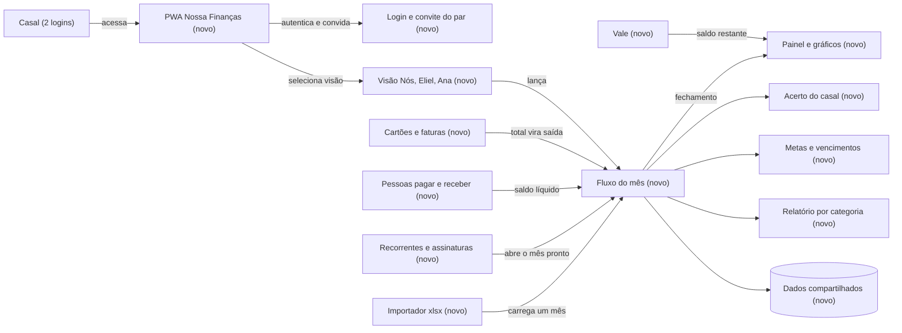

# SPEC: nossa-financas-app-casal

## Metadata
- Source: developer description via /plan + mudanças aprovadas do design (`.handoff/mudancas-design.md`)
- Service: Nossa Finanças (app único, repositório sem código)
- Tier: complete
- Version: 2.1 (substitui a v2.0; aplica respostas do desenvolvedor em `.handoff/clarifier-answers.md`)
- Architecture references: missing
- [NEEDS CLARIFICATION] Missing architecture guidance source (run /ai-context). Repositório sem AGENTS.md, docs/agents/* ou .github/copilot-instructions.md.

## Context
Um casal controla hoje suas finanças na planilha `Planejamento_Ana_Claudia.xlsx` (aba "Orç - Mês"), que traz por mês: entradas e saídas com checkbox "Pago"; fechamento (entradas − saídas); cartões (Bradesco, Cresol) com lançamentos fixos e parcelados cujo total vira a saída "Cartão Bradesco"; pessoas (Madrinha, Glória, Mãe) com listas Pagar/Receber cujo saldo entra no fluxo; e o Vale mensal (2.250) com gastos pessoais.

Dados reais da planilha (somente Setembro): saldo Madrinha +115 (a receber 415 − a pagar 300); Cartão Bradesco 600 (2 fixos de 300); Cresol 0; Vale 2.250 sem gastos; fechamento −485; Glória e Mãe sem pendências. A planilha NÃO tem categorias, assinaturas nem datas: esses itens são apenas estrutura do app e nunca dados reais.

O app "Nossa Finanças" substitui a planilha: PWA mobile-first para dois usuários (exemplos: Eliel e Ana) com dados compartilhados e regra de leitura/escrita por dono. O design aprovado traz seletor de visão (Nós, Eliel, Ana), mês que abre pronto, lançamento rápido, categorias, recorrência, fatura de cartão, acerto do casal, metas, painel e relatórios. Greenfield; stack indefinida.

Papéis (Eliel e Ana são nomes de exemplo; os papéis são "Parceiro A" e "Parceiro B" do casal):

| Papel | Lê | Escreve |
|-------|----|---------|
| Eliel | Dados próprios e da Ana (esta em somente leitura) | Apenas itens em que é o dono |
| Ana | Dados próprios e do Eliel (este em somente leitura) | Apenas itens em que é a dona |
| Visão "Nós" | Dados de ambos agregados | Pode lançar; o item fica no nome de quem lança, e "De quem" pode ser trocado entre os dois (RF-03) |
| Não autenticado / fora do casal | Nada | Nada |

## AS IS — Estado atual

_AS IS não aplicável — feature greenfield._

## TO BE — Estado proposto

Todos os nós são novos. Realizam: login e convite (RF-28, RF-29), visões e papéis (RF-01 a RF-03, RF-30), fluxo (RF-04 a RF-09), mês pronto e recorrência (RF-10, RF-11, RF-18), cartões (RF-13 a RF-15), pessoas (RF-16), vale (RF-17), acerto (RF-19), metas (RF-20, RF-21), painel e relatório (RF-22 a RF-24), importação (RF-27, CT-01).

## Scope
- **In**: visões Nós/Eliel/Ana com papéis; lançamento rápido; categorias; recorrência; cartões e faturas; pessoas; vale; acerto do casal; metas e vencimentos; painel e gráficos; relatório; extrato; importação de .xlsx; login e convite; PWA mobile-first com navegação celular e PC.
- **Out**: Open Finance/integração bancária, múltiplas moedas, múltiplos casais, notificações push, exportação para .xlsx.

## RIGID (Non-Negotiable)

### Functional Requirements

#### Papéis, visões e acesso
- RF-01 [State-Driven]: WHILE autenticado, THE sistema SHALL oferecer o seletor de visão com as opções "Nós", o nome do usuário e o nome do par.
  - AC: As 3 opções aparecem; escolher uma muda os dados exibidos para o recorte correspondente.
- RF-02 [Unwanted]: IF um usuário tenta criar, editar ou excluir um item cujo dono é o outro parceiro, THEN THE sistema SHALL recusar a operação e manter o item inalterado.
  - AC: Na visão do par, nenhum controle de escrita é exibido (somente leitura); requisição de escrita direta sobre item do par é recusada e o item permanece idêntico.
- RF-03 [Ubiquitous]: THE sistema SHALL registrar um dono ("De quem") em cada lançamento, cartão e vale, e SHALL exibir na visão "Nós" a união dos itens de ambos.
  - AC: Cada item tem dono; a visão "Nós" soma entradas e saídas dos dois donos.
  - Regra: na visão "Nós" o usuário pode lançar; o dono padrão é quem lança e "De quem" pode ser trocado entre Eliel e Ana. Itens que pertencem ao par continuam somente leitura (RF-02).
  - AC: Em "Nós", lançamento criado por Eliel tem dono Eliel; trocar "De quem" para Ana grava o item com dono Ana.
- RF-30 [State-Driven]: WHILE autenticado, THE sistema SHALL apresentar aos dois parceiros o mesmo conjunto de dados do casal, com alterações de um visíveis ao outro, e SHALL ocultar todo dado de usuários fora do casal.
  - AC: Lançamento criado pelo parceiro A é visível ao parceiro B após recarregar; usuário fora do casal não vê nenhum dado.

#### Lançamentos e fluxo do mês
- RF-04 [Event-Driven]: WHEN o usuário autenticado salva um lançamento informando tipo (Entrada ou Saída), valor, categoria, nome, "Pago com" (cartão, opcional), "De quem", "Já está pago" e Repetir, THE sistema SHALL persistir o lançamento no mês correspondente.
  - AC: Após salvar, o lançamento aparece no mês e no Extrato com os campos informados; "Já está pago" desmarcado resulta em estado "não pago".
- RF-05 [Event-Driven]: WHEN o usuário digita uma frase rápida no formato "<valor> <nome>" (ex.: "50 mercado") na barra do Extrato/Mês, THE sistema SHALL criar uma saída com esse valor e nome no mês exibido.
  - AC: "50 mercado" cria saída de R$ 50,00 com nome "mercado", dono = usuário atual, não paga.
  - Regra (suposição, a confirmar): a frase rápida sem categoria é gravada em "Outros"; frase fora do formato é rejeitada com mensagem e nada é gravado.
  - AC: "50 mercado" é gravada na categoria "Outros"; "mercado" (sem valor) é rejeitada com mensagem e nada é gravado.
- RF-06 [Event-Driven]: WHEN o usuário marca ou desmarca o círculo de pago de um lançamento (Extrato) ou o campo "Pago", THE sistema SHALL persistir o novo estado.
  - AC: Após recarregar, o estado permanece o escolhido.
- RF-07 [Event-Driven]: WHEN o usuário edita ou exclui um lançamento não recorrente do qual é dono, THE sistema SHALL aplicar a alteração e recalcular fechamento e totais.
  - AC: Valor editado é exibido; excluído deixa de aparecer; fechamento reflete ambos.
- RF-08 [Event-Driven]: WHEN o usuário edita ou exclui um lançamento recorrente do qual é dono, THE sistema SHALL pedir o escopo e aplicá-lo: "só este mês", "este e próximos" ou "todos, inclusive anteriores".
  - AC: Com cada uma das 3 opções, apenas as ocorrências do escopo escolhido mudam; as demais permanecem idênticas.
  - Regra: com o escopo "todos, inclusive anteriores", a alteração vale para tudo e recalcula o histórico, inclusive ocorrências já marcadas como pagas e faturas já pagas.
  - AC: Recorrente de 100 para 120 em "todos, inclusive anteriores" altera as ocorrências passadas já pagas para 120,00, e fechamentos e faturas de meses anteriores são recalculados.
- RF-09 [State-Driven]: WHILE um mês está aberto, THE sistema SHALL exibir o fechamento = soma das entradas − soma das saídas, atualizado em até 1 s após cada alteração, sem recarregar a página.
  - AC: Com entradas 115 e saídas 600 o fechamento é −485,00 (caso da planilha).
  - Regra: o fechamento conta TODOS os lançamentos; "Pago" é apenas informativo e não altera o fechamento.
- RF-10 [Event-Driven]: WHEN um mês é aberto pela primeira vez, THE sistema SHALL incluí-lo já preenchido com fixos, parcelas não quitadas, assinaturas, cartões, pessoas e vale vindos do mês anterior, sem ação manual.
  - AC: Fixo e assinatura de jan aparecem em fev; parcelado 3x iniciado em jan aparece em jan, fev e mar e não em abr; cartões e pessoas cadastrados uma vez aparecem em todos os meses.
- RF-11 [Event-Driven]: WHEN o usuário escolhe Repetir, THE sistema SHALL oferecer "Não repete", "Todo mês", "Todo ano" e "Parcelado"; para recorrentes SHALL pedir "Começa em" (padrão: hoje), "Cobra no dia" e "Termina" (Nunca ou data); para Parcelado SHALL encerrar pelo número de parcelas.
  - AC: Recorrente com término em 23/12/2027 não gera ocorrências após essa data; "Nunca" gera sem fim; parcelado de 3 parcelas mostra "parcela k/3" e não gera a 4ª.
- RF-12 [Ubiquitous]: THE sistema SHALL classificar cada lançamento em uma categoria editável (adicionar, renomear, remover), com o conjunto inicial proposto: Moradia, Mercado, Assinatura, Transporte, Saúde, Lazer, Educação, Pessoas, Vale, Outros.
  - AC: Categoria editada reflete em lançamentos, metas e relatório; lançamento sem categoria é recusado.
  - Regra (suposição, a confirmar): a lista inicial acima ainda não foi confirmada pelo usuário (não existe na planilha); ao remover categoria em uso, o sistema exige reatribuir os lançamentos a outra categoria antes de remover.
  - AC: Remover categoria com lançamentos sem escolher a categoria de destino é recusado; com destino, os lançamentos migram e a categoria some.

#### Cartões, pessoas e vale
- RF-13 [Event-Driven]: WHEN o usuário cria, edita ou remove um cartão (nome livre, dono), THE sistema SHALL persistir o cadastro uma única vez, válido para todos os meses, sem limite de quantidade e sem cartão pré-cadastrado.
  - AC: É possível criar ≥ 10 cartões com nomes distintos; Bradesco e Cresol são apenas exemplos.
- RF-14 [State-Driven]: WHILE um mês está aberto, THE sistema SHALL manter, para cada cartão com total > 0, uma saída do mês igual ao total dos lançamentos do cartão nesse mês.
  - AC: Cartão com 2 fixos de 300 gera saída = 600,00; alterar um lançamento atualiza a saída em até 1 s.
- RF-15 [Event-Driven]: WHEN o usuário informa fechamento, vencimento e limite de um cartão, THE sistema SHALL exibir a fatura do mês, as faturas de outros meses (previstas a partir dos fixos) e permitir marcar a fatura como paga.
  - AC: Fatura marcada como paga mantém o estado após recarregar; fatura futura exibe total previsto igual à soma dos fixos e parcelas do mês.
- RF-16 [Event-Driven]: WHEN o usuário cadastra uma pessoa (nome livre, cadastrada uma vez) e lançamentos "a pagar" ou "a receber", THE sistema SHALL calcular o saldo líquido = a receber − a pagar e incluí-lo no fluxo do mês (positivo como entrada, negativo como saída).
  - AC: A pagar 300 e a receber 415 resulta em +115,00 como entrada (caso Madrinha); Glória e Mãe sem pendências têm saldo 0,00 e não geram lançamento.
  - Regra: o saldo da pessoa ACUMULA entre meses (pendências não quitadas de meses anteriores compõem o saldo); a quitação segue o RF-31.
- RF-31 [Event-Driven]: WHEN o usuário cadastra uma pendência com uma pessoa (a pagar ou a receber) indicando que tem parcelas (número de parcelas e valor de cada), THE sistema SHALL gerar as parcelas e permitir marcar cada uma como paga; quando todas as parcelas estiverem pagas, a pendência SHALL ser considerada quitada e o saldo da pessoa referente a ela SHALL zerar a partir do mês seguinte ao da marcação (suposição, a confirmar).
  - AC: Pendência a receber de 300 em 3 parcelas de 100 com 2 pagas mantém saldo 100,00; ao marcar a 3ª no mês M, a pendência fica quitada e o saldo é 0,00 a partir do mês M+1, sem gerar lançamento no fluxo.
  - AC: Pendência sem parcelas permanece no saldo acumulado até ser marcada como quitada.
- RF-17 [Event-Driven]: WHEN o usuário define o valor do Vale e registra gastos pessoais (nome, valor), THE sistema SHALL exibir o saldo restante = Vale − soma dos gastos, com dono definido.
  - AC: Vale 2.250,00 com gastos 250,00 exibe 2.000,00; Vale 2.250,00 sem gastos exibe 2.250,00.
  - Regra: há um Vale POR PARCEIRO; o valor se repete todo mês e a sobra NÃO passa para o mês seguinte.
  - AC: Vale do Eliel com sobra de 500,00 em jan inicia fev com o valor cheio (2.250,00), sem somar a sobra; o Vale da Ana é independente.

#### Recorrentes, acerto, metas
- RF-18 [Event-Driven]: WHEN o usuário abre "Recorrentes", THE sistema SHALL exibir o total mensal, a lista de recorrentes e assinaturas e um formulário (nome, valor, dia, cartão, categoria, todo mês/todo ano).
  - AC: O total mensal = soma dos recorrentes mensais ativos (anuais entram só no mês de cobrança); item criado aparece na lista e no mês.
- RF-19 [Event-Driven]: WHEN o usuário configura a divisão (padrão 50/50) e registra quem pagou cada gasto, THE sistema SHALL exibir "X deve R$ Y a Z" e permitir marcar o acerto como realizado.
  - AC: Gastos conjuntos de 200 pagos só pelo Eliel com 50/50 exibem "Ana deve R$ 100,00 a Eliel"; após acertar, a dívida exibida é 0,00.
- RF-20 [State-Driven]: WHILE existir meta geral ou limite por categoria, THE sistema SHALL exibir um aviso quando o gasto atingir 80% e outro ao atingir 100% da meta.
  - AC: Meta 1.000 com gasto 800,00 exibe aviso de 80%; com 1.000,00 exibe aviso de 100%; com 799,99 não exibe aviso.
  - Regra (suposição, a confirmar): os avisos de 80% e 100% aparecem só dentro do app (banner no Início e em Metas); sem e-mail e sem push.
- RF-21 [State-Driven]: WHILE na área de vencimentos, THE sistema SHALL listar os itens não pagos que vencem nos próximos 7 dias.
  - AC: Item vencendo em 7 dias aparece; em 8 dias ou já pago não aparece.

#### Painel, relatório, extrato, navegação
- RF-22 [State-Driven]: WHILE o Início está aberto, THE sistema SHALL exibir saldo do mês, entradas, saídas, gastos do mês, cartões e pessoas em lista, vale e as últimas movimentações.
  - AC: Os 7 itens estão presentes e coerentes com o mês; cartões e pessoas aparecem em lista, não em cartões grandes.
- RF-23 [State-Driven]: WHILE o painel de gráficos está aberto, THE sistema SHALL exibir gráfico de linha (evolução), barras (mês × mês anterior por categoria), rosca por categoria e ranking de maiores gastos, com períodos 3 meses, 6 meses e ano.
  - AC: Os 4 gráficos aparecem; trocar o período recalcula todos.
- RF-24 [Event-Driven]: WHEN o usuário abre o relatório, THE sistema SHALL exibir o total por categoria e a comparação com o mês anterior (valor e variação percentual).
  - AC: Categoria com 300 no mês e 200 no anterior mostra variação +50%.
- RF-25 [Event-Driven]: WHEN o usuário aplica o filtro Todos, Pendentes ou Pagos ou digita uma busca no Extrato, THE sistema SHALL listar apenas os lançamentos correspondentes.
  - AC: "Pendentes" lista só não pagos; busca "mercado" lista só lançamentos cujo nome contém "mercado".
- RF-26 [Event-Driven]: WHEN o usuário navega para o mês anterior, seguinte ou escolhe mês/ano, THE sistema SHALL exibir os dados daquele mês, identificado por mês e ano.
  - AC: Funciona para meses passados e futuros.

#### Importação e acesso
- RF-27 [Event-Driven]: WHEN o usuário envia um .xlsx no formato "Orç - Mês" e escolhe o mês de destino, THE sistema SHALL exibir uma prévia e, somente após confirmação, importar entradas e saídas (com Pago), cartões e lançamentos, pessoas com pagar/receber, e valor e gastos do Vale.
  - AC: Com `Planejamento_Ana_Claudia.xlsx` a prévia e o mês importado mostram Cartão Bradesco 600,00, Madrinha +115,00, Vale 2.250,00 e fechamento −485,00.
  - AC: Arquivo inválido é rejeitado com mensagem e nenhum dado é gravado; sem confirmar, nada é gravado.
  - Regra: se o mês de destino já tem dados, a importação é recusada com aviso (o usuário limpa o mês ou escolhe outro); nada é gravado.
  - Regra (suposição, a confirmar): o dono dos itens importados é quem importa, e a prévia permite trocar por item; na coluna "Parcelamento/Data", formato "k/n" ou número = parcelado, vazia = fixo (confirmar com mais amostras).
  - AC: Importar em mês com dados exibe aviso de recusa e o mês permanece idêntico.
- RF-28 [Ubiquitous]: THE sistema SHALL exigir autenticação individual (um login por parceiro) para qualquer acesso a dados e SHALL oferecer "Sair".
  - AC: Requisição sem sessão válida é recusada e redirecionada ao login; "Sair" encerra a sessão.
  - Regra: o login é por e-mail e senha.
- RF-29 [Event-Driven]: WHEN um parceiro usa "Convidar par" informando o contato do par, THE sistema SHALL gerar um convite que, ao ser aceito, vincula o segundo login ao mesmo casal.
  - Regra: o convite é um link enviado ao e-mail do par.
  - AC: Após aceite, ambos veem os mesmos dados; convite não aceito não concede acesso; casal não aceita um 3º usuário.

### UI Requirements
- UI-01 [Ubiquitous]: THE sistema SHALL ser um PWA instalável, mobile-first, utilizável a partir de 360 px, sem rolagem horizontal (design aprovado em 390 px).
  - AC: Lighthouse PWA marca "instalável"; sem rolagem horizontal em 360 px e em desktop.
- UI-02 [Ubiquitous]: THE interface SHALL oferecer no celular a barra: Início, Extrato, + (lançar), Cartões, Mais; "Mais" SHALL conter Pessoas, Vale, Recorrentes, Acerto, Metas, Relatório, Importar, Convidar par e Sair.
  - AC: Os 5 itens da barra e os 9 itens de "Mais" existem e abrem a tela correspondente.
- UI-03 [Ubiquitous]: THE interface SHALL oferecer no PC menu lateral com as mesmas áreas da navegação do celular.
  - AC: Todas as áreas de UI-02 são alcançáveis pelo menu lateral em largura ≥ 1024 px.
- UI-04 [Event-Driven]: WHEN o usuário toca em "+", THE interface SHALL abrir o lançamento com teclado de valor e alternância Saída/Entrada, permitindo salvar um lançamento simples em no máximo 3 toques após abrir o "+".
  - AC: Contagem de interações do "+" até salvar ≤ 3 em teste manual.
- UI-05 [State-Driven]: WHILE na tela do mês, THE interface SHALL mostrar o fechamento em destaque com sinal e rótulo distintos para positivo e negativo (nunca só cor).
  - AC: Fechamento negativo exibe "−" e rótulo, além da cor.
- UI-06 [Ubiquitous]: THE interface SHALL exibir valores em reais com duas casas decimais, em pt-BR.
  - AC: 2250 é exibido como "R$ 2.250,00".
- UI-07 [State-Driven]: WHILE exibindo itens do outro parceiro, THE interface SHALL identificá-los como "somente leitura" e ocultar os controles de edição.
  - AC: Na visão do par, não há botão de editar, excluir nem marcar pago.

### Contracts
- CT-01: Formato de importação — .xlsx com aba "Orç - Mês" e o layout da planilha de origem (Entradas/Saídas, Cartões, Pessoas, Vale). (verified at `Planejamento_Ana_Claudia.xlsx`, aba "Orç - Mês", leitura da planilha)
- [NEEDS CLARIFICATION] Contratos de API/endpoints não definidos: stack e backend não escolhidos; nenhum endpoint congelado.

### Non-Functional Requirements
- RNF-01: Recálculo do fechamento e totais após alteração ≤ 1 s (p95) com 200 lançamentos no mês.
- RNF-02: Carregamento da tela do mês ≤ 2 s (p95) em 4G com 200 lançamentos.
- RNF-03: Dados trafegam somente via HTTPS e ficam acessíveis apenas aos 2 usuários autenticados do casal; a regra de escrita por dono (RF-02) é imposta no servidor, não só na interface.
- RNF-04: Importação de planilha com ≤ 500 linhas concluída em ≤ 10 s.
- RNF-05: Cálculos monetários com precisão de centavos, sem erro de ponto flutuante (percentuais de metas e acerto arredondados a 2 casas).
- RNF-06: Contraste mínimo WCAG 2.1 AA nas telas principais.
- RNF-07: Abrir um mês seguinte pronto (RF-10) em ≤ 2 s (p95) com 200 lançamentos herdados.
- RNF-08: Offline somente LEITURA do último mês carregado; escrita exige internet (sem sincronização offline).
  - AC: Sem conexão, o último mês carregado é exibido sem controles de escrita ativos; tentativa de gravar informa que é necessário internet e nada é gravado.
- [NEEDS CLARIFICATION] Stack e backend não escolhidos.

## FLEXIBLE (Implementation Suggestions)
- Stack a decidir: por exemplo SPA com service worker e backend com banco relacional e autenticação gerenciada.
- Valores em centavos inteiros; recorrência como regra (frequência, início, dia, término ou nº de parcelas) com ocorrências materializadas por mês; sobrescritas por escopo (RF-08) como exceções à regra.
- Autorização por dono centralizada na camada de serviço; seguir separação controller → serviço → repositório quando houver /ai-context.
- Importador em módulo separado com prévia antes de gravar.
- Gráficos com biblioteca leve; frase rápida com parser simples "<valor> <texto>".

## Acceptance Criteria Summary
| ID | Criterion | Testable? |
|----|-----------|-----------|
| AC1 | Visões e papéis: leitura do par, escrita só do dono (RF-01 a RF-03, RF-30, UI-07) | Sim |
| AC2 | Lançar rápido, pago, editar/excluir com escopo (RF-04 a RF-08, UI-04) | Sim |
| AC3 | Fechamento e mês pronto (RF-09, RF-10, UI-05) | Sim |
| AC4 | Repetir, recorrentes e categorias (RF-11, RF-12, RF-18) | Sim |
| AC5 | Cartões, faturas, pessoas com parcelas, vale (RF-13 a RF-17, RF-31) | Sim |
| AC6 | Acerto, metas e vencimentos (RF-19 a RF-21) | Sim |
| AC7 | Painel, gráficos, relatório, extrato, navegação (RF-22 a RF-26, UI-02, UI-03) | Sim |
| AC8 | Importar .xlsx com prévia (RF-27, CT-01) | Sim |
| AC9 | Login e convite (RF-28, RF-29) | Sim |
| Plataforma | PWA mobile-first (UI-01, RNF-01, RNF-02) | Sim |

Marcadores [NEEDS CLARIFICATION] abertos: 3 (arquitetura de referência, contratos de API, stack e backend), todos decisões técnicas para o plano. Padrões marcados "(suposição, a confirmar)": RF-05, RF-12, RF-20, RF-27, RF-31.

## Distribution by Repo
| Repo | RFs | Contracts |
|------|-----|-----------|
| Nossa-finan-as (único) | RF-01 a RF-31 | CT-01 |
